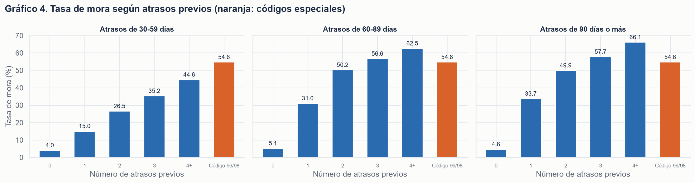
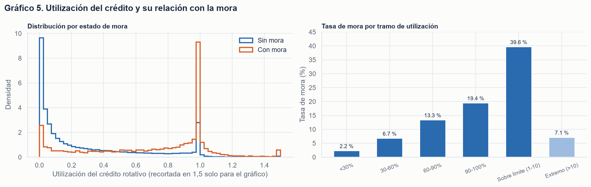
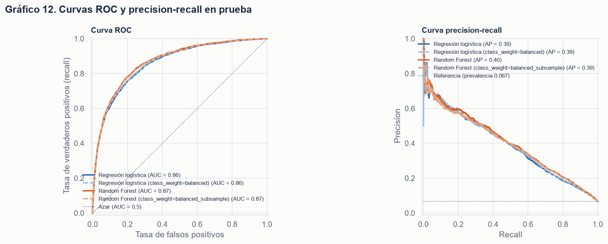
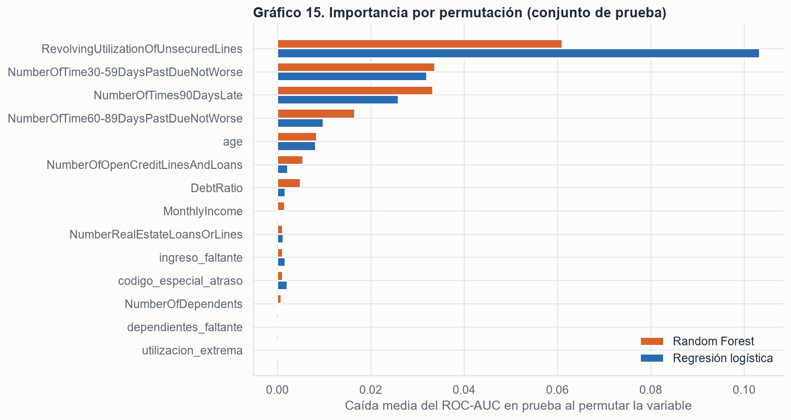
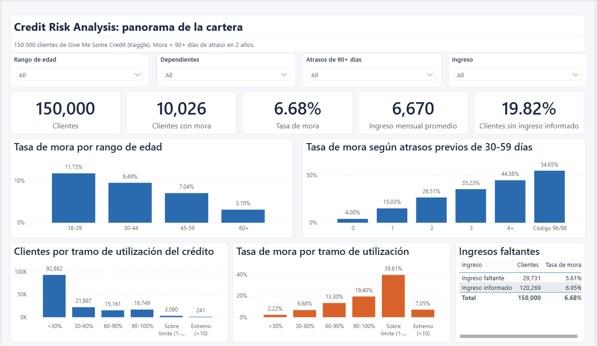
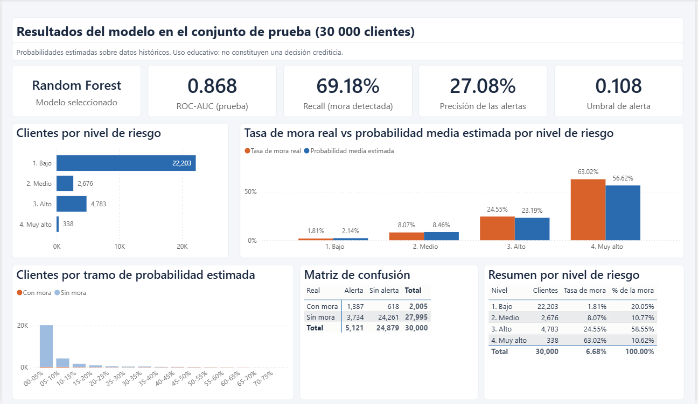

# Credit Risk Analysis

Análisis de riesgo crediticio de extremo a extremo con el dataset **Give Me Some Credit** de Kaggle:
calidad de datos, consultas SQL de negocio, análisis exploratorio, modelos de probabilidad de mora
(regresión logística y Random Forest) y un dashboard de Power BI para analistas de riesgo.

> **Aviso.** Proyecto con fines educativos y de portafolio. Los resultados se obtienen con datos
> históricos públicos y **no constituyen una decisión crediticia real** ni una evaluación de personas.

---

## 1. Problema de negocio

Una entidad financiera necesita anticipar qué clientes tienen mayor probabilidad de entrar en **mora grave
(90 días o más de atraso) durante los próximos dos años** para priorizar revisiones, ajustar límites o
diseñar acciones preventivas. Revisar a todos los clientes es costoso; no detectar a tiempo a los que
caerán en mora también lo es.

## 2. Objetivo analítico

1. Identificar patrones asociados con el incumplimiento.
2. Estimar la probabilidad de mora de cada cliente con un modelo validado sin fuga de información.
3. Elegir un umbral de alerta que equilibre detección de morosos y falsas alarmas.
4. Comunicar los resultados en un dashboard orientado a un analista de riesgo.

## 3. Datos

* **Fuente:** [Kaggle – Give Me Some Credit](https://www.kaggle.com/c/GiveMeSomeCredit/data) (2011).
* **Archivo utilizado:** `cs-training.csv` (150 000 clientes, 11 columnas + identificador de fila).
  `cs-test.csv` **no se usa**: no contiene la etiqueta real.
* **Objetivo:** `SeriousDlqin2yrs` (1 = mora de 90+ días en los dos años siguientes; 0 = no).
* El dataset **no se incluye** en el repositorio (ver [Instalación](#13-instalación-y-ejecución)).

| Variable | Descripción (diccionario de Kaggle) |
|---|---|
| `SeriousDlqin2yrs` | Mora de 90 días o más en los dos años siguientes (objetivo) |
| `RevolvingUtilizationOfUnsecuredLines` | Saldo de tarjetas y líneas personales / suma de sus límites |
| `age` | Edad del titular en años |
| `NumberOfTime30-59DaysPastDueNotWorse` | Veces con 30-59 días de atraso (sin llegar a más) en los últimos 2 años |
| `DebtRatio` | Pagos mensuales de deuda y gastos de vida / ingreso bruto mensual |
| `MonthlyIncome` | Ingreso mensual |
| `NumberOfOpenCreditLinesAndLoans` | Préstamos y líneas de crédito abiertos |
| `NumberOfTimes90DaysLate` | Veces con 90 días o más de atraso |
| `NumberRealEstateLoansOrLines` | Préstamos hipotecarios o inmobiliarios |
| `NumberOfTime60-89DaysPastDueNotWorse` | Veces con 60-89 días de atraso (sin llegar a más) en los últimos 2 años |
| `NumberOfDependents` | Dependientes en la familia, sin contar al titular |

## 4. Herramientas

Python 3.12, pandas, NumPy, Matplotlib, Seaborn, scikit-learn, SQLite, Jupyter, joblib, pytest y
Power BI Desktop (proyecto .pbip).

## 5. Estructura del repositorio

```
credit-risk-analysis/
├── data/                     # cs-training.csv va aquí (no versionado) + README con instrucciones
├── sql/consultas.sql         # 9 consultas de negocio para SQLite
├── notebooks/
│   ├── 01_eda.ipynb          # calidad de datos, EDA y reglas de limpieza
│   └── 02_modelo.ipynb       # modelos, umbral, evaluación, interpretabilidad y exportación
├── src/
│   ├── cargar_datos.py       # carga, validación y resumen de calidad
│   ├── limpieza.py           # reglas de limpieza deterministas + segmentos
│   ├── ejecutar_sql.py       # carga en SQLite y ejecuta sql/consultas.sql
│   ├── entrenamiento.py      # pipelines, validación cruzada, umbral, métricas, guardado
│   ├── generar_dashboard.py  # CSV para Power BI
│   ├── generar_pbip.py       # proyecto de Power BI (.pbip) con modelo, medidas y visuales
│   └── graficos.py           # estilo común de los gráficos
├── dashboard/
│   ├── powerbi/CreditRisk.pbip  # informe de Power BI (abrir con Power BI Desktop)
│   ├── medidas_dax.md        # importación, relaciones, medidas DAX, diseño y valores de control
│   ├── tema_credit_risk.json # tema de Power BI (paleta del informe)
│   ├── metricas_modelo.csv   # métricas de prueba de todos los modelos
│   ├── datos_dashboard.csv   # predicciones del conjunto de prueba (generado, no versionado)
│   ├── cartera.csv           # cartera completa con segmentos (generado, no versionado)
│   └── capturas/             # capturas del dashboard abierto en Power BI Desktop
├── reports/                  # resumen de calidad, resultados SQL, métricas, configuración y figuras
├── models/                   # modelo entrenado .joblib (generado, no versionado)
├── tests/test_proyecto.py    # 16 pruebas con pytest
├── requirements.txt
├── LICENSE
└── README.md
```

## 6. Calidad de datos y decisiones de limpieza

Resultado de `python -m src.cargar_datos` y de `01_eda.ipynb`:

| Problema | Filas | Decisión | Motivo |
|---|---|---|---|
| `MonthlyIncome` nulo | 29 731 (19,82 %) | Imputar mediana (solo con entrenamiento) + indicador `ingreso_faltante` | Eliminar perdería el 20 % de la cartera; la ausencia se asocia con la mora (5,61 % vs 6,95 %) |
| `NumberOfDependents` nulo | 3 924 (2,62 %) | Mediana + indicador `dependientes_faltante` | Todos estos clientes tampoco informan ingreso |
| `age` = 0 | 1 | Nulo → mediana | Edad imposible; las 13 personas de más de 100 años se conservan |
| Códigos 96/98 en atrasos | 269 | Nulo → mediana + indicador `codigo_especial_atraso` | Aparecen siempre en las tres columnas a la vez y no son conteos posibles, pero esos clientes tienen 54,65 % de mora |
| Utilización > 10 | 241 | Nulo → mediana + indicador `utilizacion_extrema` | Su mora (7,05 %) es igual a la media: se comportan como errores. Los valores entre 1 y 10 (sobre el límite, 39,61 % de mora) se conservan |
| `DebtRatio` muy alto con ingreso nulo | 27 904 con ratio > 1 | Se conserva; el indicador de ingreso permite distinguir el caso | Sin ingreso, el valor parece ser deuda absoluta (mediana 1 159 vs 0,30) |
| Filas duplicadas (sin id) | 609 | Se conservan | No hay identificador de persona; perfiles idénticos pueden ser clientes distintos |

Las reglas son deterministas fila a fila (`src/limpieza.py`), no modifican el archivo original (se verifica
con su SHA-256) y registran cuántas filas afecta cada una. La imputación por mediana vive dentro del
pipeline de scikit-learn y se ajusta solo con el conjunto de entrenamiento. En validación cruzada,
**mediana + indicadores** superó a **solo mediana** (ROC-AUC 0,8528 vs 0,8506 en la logística; 0,8637 vs
0,8629 en Random Forest).

## 7. Consultas SQL

`sql/consultas.sql` contiene 9 consultas ejecutables en SQLite con `CASE WHEN`, agregaciones y división
segura (`1.0 * a / NULLIF(b, 0)`). Las edades inválidas, los nulos y los códigos 96/98 se agrupan en
categorías propias antes de interpretar. Resultados completos en `reports/resultados_sql.md`.

| Consulta | Pregunta | Resultado principal |
|---|---|---|
| q1 | Clientes y tasa global de mora | 150 000 clientes, 10 026 con mora (6,68 %) |
| q2 | Mora por rango de edad | 18-29: 11,73 %; 30-44: 9,49 %; 45-59: 7,04 %; 60+: 3,10 % |
| q3 | Mora por atrasos de 30-59 días | 0: 4,00 %; 1: 15,03 %; 2: 26,51 %; 4+: 44,58 %; código 96/98: 54,65 % |
| q4 | Ingreso promedio con y sin mora | 5 631 con mora vs 6 748 sin mora (solo ingresos informados) |
| q5 | Clientes con ingreso faltante | 29 731 (19,82 %), mora 5,61 % |
| q6 | Mora por dependientes | de 5,86 % (ninguno) a 10,28 % (4 o más) |
| q7 | Utilización por estado de mora | promedio (≤ 100 %) 0,638 con mora vs 0,283 sin mora; 12,34 % vs 1,49 % sobre el límite |
| q8 | Mora por tramo de utilización | de 2,22 % (< 30 %) a 39,61 % (sobre el límite) |
| q9 | Concentración de la mora en atrasos de 90+ días | el 5,6 % de clientes con algún atraso de 90+ días o código especial concentra el 34,6 % de la mora |

## 8. Hallazgos del análisis exploratorio

1. **Desbalance:** solo el 6,68 % de los clientes cae en mora; un modelo que nunca predice mora tendría
   93,32 % de accuracy y sería inútil.
2. **El historial de atrasos es la señal más fuerte:** un atraso de 90+ días eleva la mora de 4,63 % a
   33,66 %; dos o más, a 55,20 %.
3. **Utilización del crédito:** mediana 0,838 en clientes con mora frente a 0,133 sin mora.
4. **Edad:** la mora baja de forma monótona con la edad (11,73 % en 18-29 años, 3,10 % en 60+).
5. **Ingreso y dependientes:** relación más débil pero consistente (9,21 % de mora en el cuartil de
   ingreso más bajo frente a 4,62 % en el más alto).
6. **Correlación de Spearman con la mora:** atrasos de 90+ días 0,335, de 60-89 días 0,268, de 30-59 días
   0,251, utilización 0,241, edad −0,117.

<p align="center">
  
</p>
<p align="center">
  
</p>

## 9. Modelos

**Protocolo:** división estratificada 80/20 (`random_state=42`); pipelines con imputación, `log1p` y
escalado (solo logística); validación cruzada estratificada de 5 pliegues **dentro del entrenamiento** para
comparar imputación, elegir el modelo (ROC-AUC) y fijar el umbral (máximo F2). El conjunto de prueba
(30 000 clientes) se usa una sola vez para la evaluación final.

### Métricas en el conjunto de prueba

| Modelo | ROC-AUC CV (train) | ROC-AUC prueba | Avg. precision | Umbral | Recall | Precision | F1 | Accuracy |
|---|---|---|---|---|---|---|---|---|
| Referencia (clase mayoritaria) | 0,5000 | 0,5000 | 0,0668 | – | 0,00 % | 0,00 % | 0,0000 | **93,32 %** |
| Regresión logística | 0,8528 | 0,8590 | 0,3903 | 0,084 | 69,18 % | 25,29 % | 0,3704 | 84,28 % |
| Regresión logística (balanced) | 0,8545 | 0,8608 | 0,3929 | 0,560 | 68,53 % | 25,78 % | 0,3747 | 84,71 % |
| **Random Forest** ✔ | **0,8643** | **0,8680** | **0,4014** | 0,108 | 69,18 % | **27,08 %** | **0,3893** | 85,49 % |
| Random Forest (balanced_subsample) | 0,8634 | 0,8666 | 0,3937 | 0,537 | 70,62 % | 25,88 % | 0,3788 | 84,52 % |

Matriz de confusión del modelo seleccionado (prueba): **1 387** morosos detectados, **618** no detectados,
**3 734** falsas alarmas y **24 261** verdaderos negativos.

**Por qué no la accuracy:** el clasificador de referencia tiene la mayor accuracy sin detectar ni un
moroso. Con ~7 % de positivos, la accuracy premia predecir siempre la clase mayoritaria.

**Umbral:** con 0,5 el Random Forest solo detectaría el 10,4 % de los morosos (validación cruzada). El
umbral **0,1077**, que maximiza F2 (el recall pesa el doble que la precision, porque no detectar un moroso
suele costar más que una revisión extra), detecta el 68,8 % en validación cruzada y el 69,2 % en prueba.
Con capacidad de revisión limitada, el umbral de máximo F1 (0,2167) ofrecería recall 49,1 % y precision 40,3 %.

**Modelo recomendado: Random Forest sin ponderación de clases.** Mejor ROC-AUC en validación cruzada y en
prueba, menos falsas alarmas con el mismo recall que la logística y probabilidades bien calibradas.
`class_weight` no mejoró el ordenamiento: el ajuste de umbral logra el mismo efecto sin distorsionar las
probabilidades. La regresión logística (0,007 puntos de AUC menos) es una alternativa válida si se prioriza
la explicabilidad.

<p align="center">
  
</p>

### Niveles de riesgo (conjunto de prueba)

| Nivel | Regla | Clientes | Prob. media | Mora real | % de toda la mora |
|---|---|---|---|---|---|
| 1. Bajo | p < tasa base (0,0668) | 22 203 | 2,14 % | 1,81 % | 20,0 % |
| 2. Medio | tasa base ≤ p < umbral (0,1077) | 2 676 | 8,46 % | 8,07 % | 10,8 % |
| 3. Alto | umbral ≤ p < 0,5 | 4 783 | 23,19 % | 24,55 % | 58,6 % |
| 4. Muy alto | p ≥ 0,5 | 338 | 56,62 % | 63,02 % | 10,6 % |

Los niveles Alto y Muy alto concentran el 17,1 % de los clientes y el 69,2 % de la mora.

## 10. Variables más predictivas

Según la importancia por permutación en prueba (caída del ROC-AUC), la importancia del Random Forest y
los coeficientes de la logística:

1. **Utilización del crédito rotativo** (−0,061 de AUC al permutarla en Random Forest; −0,103 en la logística).
2. **Atrasos previos** de 30-59, 90+ y 60-89 días (−0,010 a −0,034).
3. **Edad**, con asociación negativa (odds ratio 0,81 por desviación estándar en la logística).
4. Ingreso, ratio de deuda, dependientes y préstamos inmobiliarios aportan poco una vez considerados los
   anteriores.

El indicador `codigo_especial_atraso` tiene el mayor coeficiente de la logística (odds ratio 11,3), pero
afecta solo al 0,18 % de los clientes. Son **asociaciones predictivas, no causales**.

<p align="center">
  
</p>

## 11. Dashboard de Power BI

El informe es un proyecto de Power BI (`dashboard/powerbi/CreditRisk.pbip`, formato TMDL/PBIR)
generado con `python -m src.generar_pbip`: modelo de datos, 23 medidas DAX y las páginas
**Panorama de la cartera** y **Resultados del modelo**. Se abrió y comprobó en Power BI Desktop: las
cifras coinciden con los valores de control calculados en Python. La primera vez que se abre hay que
pulsar **Inicio → Actualizar** para cargar los CSV. `dashboard/medidas_dax.md` documenta:

* Importación de `cartera.csv` (150 000 filas), `datos_dashboard.csv` (30 000 predicciones de prueba) y
  `metricas_modelo.csv`, incluida la configuración regional necesaria para el punto decimal.
* Relaciones, formatos y agregaciones.
* 20+ medidas DAX con `DIVIDE`: `Total Clientes`, `Clientes con Mora`, `Tasa de Mora`, `Ingreso Promedio`,
  `Tasa de Mora por Segmento`, `% de la Mora Capturada`, `Recall Modelo`, `Precision Modelo`, etc.
* Maquetación de las dos páginas (**Panorama de la cartera** y **Resultados del modelo**), tema
  `tema_credit_risk.json` (azul oscuro, azul claro y naranja para alertas sobre fondo claro).
* Tabla de valores de control para comprobar que el informe reproduce las cifras de Python.

## 12. Capturas

Capturas del informe en Power BI Desktop, sin filtros aplicados.

**Página 1 – Panorama de la cartera**



**Página 2 – Resultados del modelo** (conjunto de prueba)



## 13. Instalación y ejecución

Requisitos: Python 3.11 o superior (probado con 3.12) y Git. Power BI Desktop (Windows) para el dashboard.

```bash
git clone https://github.com/PaolaRuizV/credit-risk-analysis.git
cd credit-risk-analysis

python -m venv .venv
# Windows (PowerShell):  .venv\Scripts\Activate.ps1
# macOS / Linux:         source .venv/bin/activate
pip install -r requirements.txt
```

Descarga `cs-training.csv` desde [Kaggle](https://www.kaggle.com/c/GiveMeSomeCredit/data) (requiere
cuenta y aceptar las reglas del concurso) y colócalo en `data/`. Opcionalmente copia también
`Data Dictionary.xls`, que usa el notebook de EDA.

Ejecuta desde la raíz del proyecto, en este orden:

```bash
python -m src.cargar_datos          # resumen de calidad -> reports/
python -m src.ejecutar_sql          # SQLite + consultas -> reports/resultados_sql.md
jupyter nbconvert --to notebook --execute --inplace notebooks/01_eda.ipynb
jupyter nbconvert --to notebook --execute --inplace --ExecutePreprocessor.timeout=1800 notebooks/02_modelo.ipynb
python -m src.generar_pbip         # proyecto de Power BI -> dashboard/powerbi/CreditRisk.pbip
python -m pytest -v
```

`02_modelo.ipynb` entrena los modelos (≈3-5 minutos), guarda los artefactos y genera los CSV del dashboard.
Sin Jupyter, el mismo flujo se ejecuta con `python -m src.entrenamiento` seguido de
`python -m src.generar_dashboard`.

En VS Code: abre la carpeta, selecciona el intérprete `.venv` (Ctrl+Shift+P → *Python: Select
Interpreter*) y abre los notebooks con ese kernel. En Jupyter: `jupyter notebook` desde la raíz.

## 14. Limitaciones, riesgos y mejoras

* **Datos antiguos (2011) y sin fechas:** no hay validación temporal ni variables macroeconómicas; el
  rendimiento puede degradarse con cambios de contexto (*drift*).
* **Sin costes reales:** el umbral usa F2 como aproximación; con costes por falso positivo y falso negativo
  debería minimizarse el coste esperado.
* **Significado de 96/98 no documentado:** su tratamiento se basa en el análisis de los datos.
* **Equidad:** la edad influye en el modelo. Antes de un uso real habría que evaluar el impacto por grupos
  y la normativa aplicable (en muchos países la edad es una variable protegida o restringida).
* **Hiperparámetros:** no se hizo una búsqueda exhaustiva. Mejoras posibles: búsqueda con validación
  cruzada, gradient boosting (p. ej. `HistGradientBoostingClassifier`), calibración explícita, SHAP para
  explicaciones individuales y monitorización del modelo.

## 15. Aviso

Resultados con fines **educativos**. Las probabilidades son estimaciones sobre datos históricos y no deben
usarse para conceder o denegar crédito a personas reales.

## Licencia

Código y documentación bajo licencia MIT (ver `LICENSE`). El dataset pertenece a sus autores y se rige por
las reglas del concurso de Kaggle.
